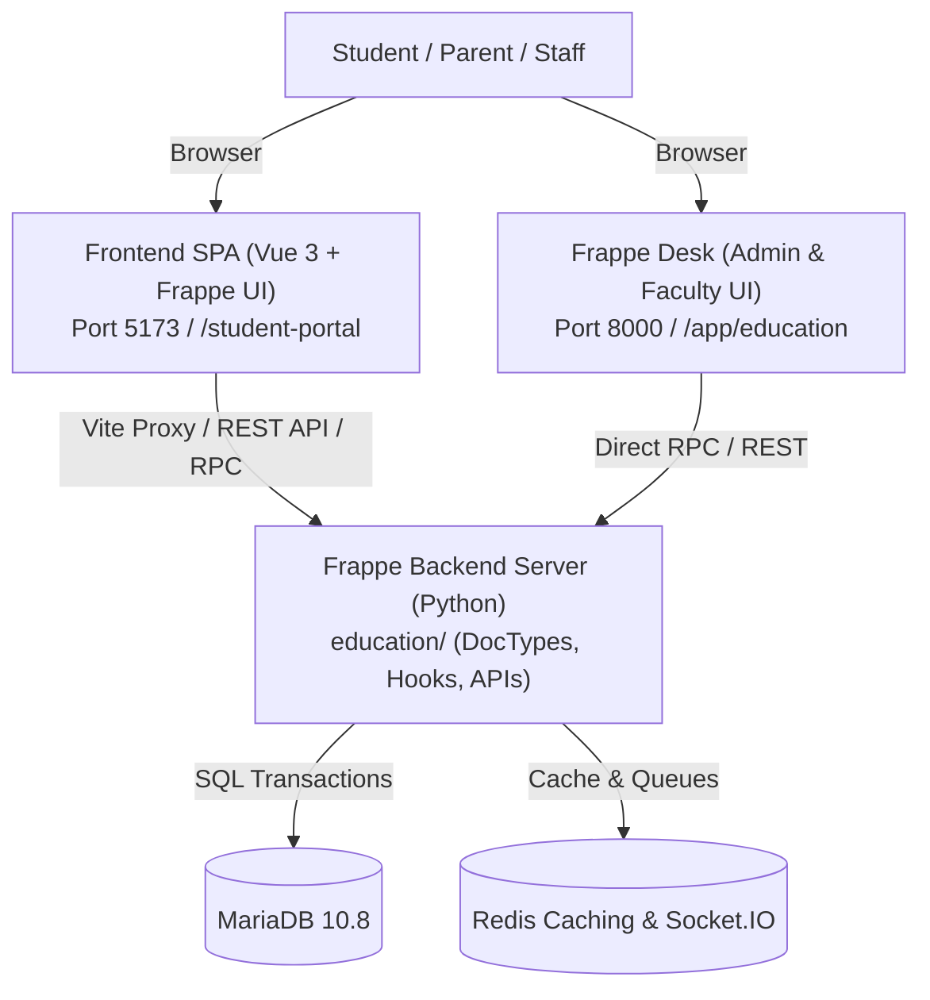

<div align="center" markdown="1">


# Frappe Education

**Empowering Schools with Smarter Management**


[](license.txt)

<br />

[Website](https://frappe.io/education) • [Documentation](https://docs.frappe.io/education) • [Community Forum](https://discuss.frappe.io/c/erpnext/schools-college-education/40) • [Telegram Group](https://t.me/frappe_education)

</div>

---

## 🏛️ System Architecture

Frappe Education is structured into a modern full-stack decoupled architecture comprising a **Python Backend (Frappe App)**, a **Vue 3 Single Page Application Frontend**, and a containerized **Docker Environment**:



---

## 📁 Repository Directory Structure

```
.
├── 🎨 frontend/                     # FRONTEND: Vue 3 + Frappe UI Single Page Application
│   ├── public/                      # Static public web assets
│   ├── src/                         # Application source code
│   │   ├── assets/                  # Inter fonts, global styles
│   │   ├── components/              # Vue UI components (Navbar, Sidebar, Modals, Forms)
│   │   ├── pages/                   # Views: Attendance, Fees, Grades, Schedule, Leaves, Diary
│   │   ├── stores/                  # Pinia state stores (session, student, user, leave)
│   │   ├── utils/                   # Helpers, formatters
│   │   ├── App.vue                  # Main application wrapper
│   │   ├── index.css                # Tailwind CSS entrypoint
│   │   ├── main.js                  # App bootstrap
│   │   └── router.js                # Vue Router route map
│   ├── index.html                   # HTML entry shell
│   ├── package.json                 # Frontend dependencies & scripts
│   ├── vite.config.js               # Vite build & Frappe API proxy config
│   ├── tailwind.config.js           # Tailwind configuration
│   └── README.md                    # Detailed Frontend documentation
│
├── ⚙️ education/                    # BACKEND: Core Frappe Python Application Package
│   ├── api/                         # REST & RPC endpoints, session & permission checks
│   ├── config/                      # Desktop icon and module configuration
│   ├── education/                   # Core Domain Models
│   │   ├── doctype/                 # 50+ DocTypes (Student, Program, Course, Fees, etc.)
│   │   ├── report/                  # Analytics and financial/academic reports
│   │   ├── web_form/                # Public admission application forms
│   │   └── workspace/               # Desk workspaces and dashboards
│   ├── overrides/                   # DocType method overrides and event hooks
│   ├── patches/                     # Database migration patches
│   ├── public/                      # Static assets served by Frappe web server
│   │   └── frontend/                # Compiled production bundle from frontend/
│   ├── templates/                   # Jinja2 web templates
│   ├── translations/                # Multilingual translations
│   ├── www/                         # Portal web routes (student-portal.html)
│   ├── hooks.py                     # Frappe event bindings, routes, and desk hooks
│   ├── install.py                   # Post-installation fixtures and setup
│   ├── modules.txt                  # Module registry
│   ├── patches.txt                  # Migration patch list
│   └── README.md                    # Detailed Backend documentation
│
├── 🐳 docker/                       # DEVOPS: Containerized Local Environment
│   ├── docker-compose.yml           # Compose stack: MariaDB, Redis, and Frappe Bench
│   └── init.sh                      # Automated site provisioning & app installation
│
├── .github/                         # CI/CD workflows and assets
├── package.json                     # Root build and dev delegate scripts
├── pyproject.toml                   # Python package definition (Flit) and Ruff linting rules
├── MANIFEST.in                      # Python package build inclusion manifest
└── README.md                        # Master architectural overview and setup guide
```

---

## 🎨 1. Frontend: Vue 3 Student Portal

The frontend is a fast, responsive Single Page Application built for students and guardians.

- **Stack**: Vue 3 (Composition API), Vite, Tailwind CSS, Frappe UI, Pinia, Vue Router.
- **Portals & Features**:
  - **Schedule**: Weekly timetable, subject schedule, and class calendar.
  - **Attendance**: Monthly attendance records and leave balance.
  - **Fees & Payments**: Invoices, payment history, and payment gateway dialog.
  - **Grades & Report Cards**: Course results, grade point averages, and quiz scores.
  - **School Diary**: Daily announcements, tasks, and teacher notes.
  - **Leave Applications**: Request leaves and track approval statuses.

👉 **See the complete [Frontend Guide](frontend/README.md)** for detailed component listings, state stores, and development proxy configuration.

---

## ⚙️ 2. Backend: Frappe Python Application

The backend is a robust educational management engine running on Frappe Framework and ERPNext.

- **Stack**: Python 3.10+, MariaDB, Redis, Frappe Bench.
- **Why `education/` is the Backend Package**:
  In Frappe, Python packages match `app_name = "education"`. Frappe dynamically resolves controllers using `import education` and `frappe.get_module(...)`.
- **Core Domains**:
  - **Admissions & Enrollment**: Multi-stage admissions, applicant registrations, and student profiles.
  - **Curriculum & Academics**: Programs, courses, subjects, academic years, and terms.
  - **Assessments & Evaluation**: Grading scales, grade books, assessment plans, quizzes, and questions.
  - **Fee Management**: Integrated with ERPNext accounting; fee structures, schedules, and receipts.
  - **Campus & Facilities**: Campus, building, floor, room scheduling, and hostel allocation.

👉 **See the complete [Backend Guide](education/README.md)** for DocType catalog, REST API endpoints, and hooks.

---

## 🚀 Quick Start & Development Setup

### Option A: Docker (Recommended for Quick Setup)

Run the entire stack with Docker Compose:

```bash
cd docker
docker compose up -d
```

The site will be available at [http://education.localhost:8000](http://education.localhost:8000).
- **Default Username**: `Administrator`
- **Default Password**: `admin`

### Option B: Local Development (Bench + Vite)

#### 1. Backend Setup
```bash
# Setup Frappe Bench environment
bench init frappe-bench
cd frappe-bench

# Fetch apps
bench get-app erpnext
bench get-app education /path/to/this/repo

# Create and configure site
bench new-site education.test
bench --site education.test install-app erpnext
bench --site education.test install-app education

# Start Frappe development server
bench start
```

#### 2. Frontend Setup
From the repository root or `frontend/` directory:
```bash
# From repository root
npm run dev

# Or directly in frontend
cd frontend
yarn
yarn dev
```
Open [http://localhost:5173](http://localhost:5173) to access the interactive Vue 3 student portal with hot-module reloading.

#### 3. Building Frontend for Production
```bash
cd frontend
yarn build
```
This builds the SPA into `education/public/frontend` and updates `education/www/student-portal.html`. The portal is then accessible directly through Frappe at `/student-portal`.

---

## 🧹 Code Quality & Linting

- **Python (Backend)**: Formatted and linted with [Ruff](https://github.com/astral-sh/ruff) via `pyproject.toml`:
  ```bash
  ruff check education
  ruff format education
  ```
- **JavaScript/Vue (Frontend)**: Formatted with Prettier:
  ```bash
  npx prettier --write "frontend/src/**/*.{js,vue,css}"
  ```

---

## 📄 License

GNU General Public License v3.0 ([GPL-3.0](license.txt)) © Frappe Technologies Pvt. Ltd.
